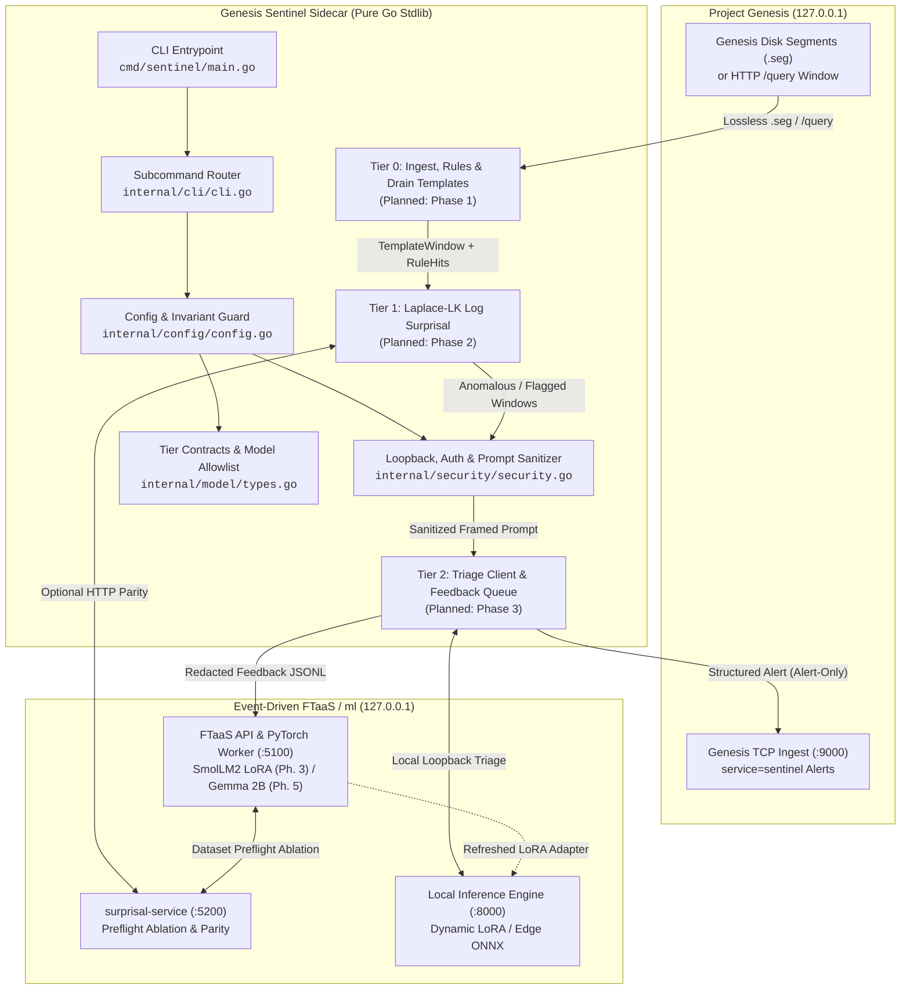
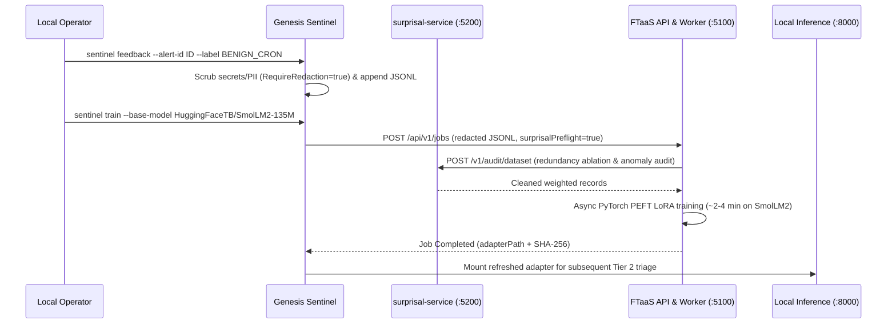

<!-- diagram-meta
last-validated: 2026-11-24
validated-commit: initial-scaffold
covers: [cmd/, internal/]
-->

# Genesis Sentinel Architecture Specification (`knowthankyew/genesis-sentinel`)

**Genesis Sentinel** is a standalone, pure-Go standard library sidecar (`go.mod` contains zero external dependencies) that monitors Project Genesis log streams through a three-tier local detection funnel—deterministic rules and template collapsing, Laplace-LK surprisal anomaly scoring, and FTaaS-trained LoRA triage—with zero external network egress.

---

## 1. End-to-End Detection & Feedback Pipeline

---

## 2. Phase 0 Implemented Subsystems

1. **CLI & Configuration Hierarchy (`cmd/sentinel/main.go`, `internal/cli/cli.go`, `internal/config/config.go`):**
   - Mirrors Genesis's single-binary subcommand router (`watch`, `scan`, `feedback`, `train`, `stats`, `burn`, `config`, `version`, `help`).
   - Merges compiled safe defaults -> `sentinel.json` -> `SENTINEL_*` environment variables -> CLI flags.
   - Redacts sensitive auth tokens automatically when rendering resolved config via `sentinel config`.
2. **Domain Contracts & Model Governance (`internal/model/types.go`):**
   - Mirrors Genesis's `parser.LogEntry` JSON contract via `LogEvent`.
   - Defines explicit wire contracts between tiers: `TemplateWindow`, `RuleHit`, `SurprisalScore`, `TriageVerdict`, and `FeedbackRecord`.
   - Enforces a fail-closed base model allowlist (`ValidateBaseModel`): SmolLM2 (`HuggingFaceTB/SmolLM2-135M`, `SmolLM2-135M-Instruct`, `SmolLM2-360M-Instruct`) for Phases 0–4, `google/gemma-2-2b-it` reserved for Phase 5, and explicit rejection (`ErrExperimentalModelExcluded`) of experimental BitNet models.
3. **Zero-Egress & Hostile-Log Security Layer (`internal/security/security.go`):**
   - Constant-time Bearer token middleware (`crypto/subtle.ConstantTimeCompare`) matching Genesis's HTTP authentication posture.
   - Strict loopback endpoint validator (`IsLoopbackEndpoint`) blocking non-loopback upstream URLs (`genesis`, `surprisal-service`, `ftaas`, `inference`) unless `allow_remote_endpoints=true` is explicitly configured.
   - Untrusted log sanitizer (`SanitizeUntrustedLogText`) neutralizing LLM chat-template delimiters (`<|...|>`, `<start_of_turn>`, `<end_of_turn>`, `<s>`, `</s>`), stripping unsafe ASCII control bytes, bounding UTF-8 byte length, and surfacing semantic prompt-injection heuristic signals as structured verdict metadata.

---

## 3. Feedback & Adapter Refresh Sequence (Phase 3 Target)

---

## 4. Non-Negotiable Architectural Invariants

1. **Zero External Go Dependencies:** `go.mod` maintains zero `require` directives for the core Sentinel binary.
2. **Localhost-by-Default Zero Egress:** All listeners and upstream service URLs enforce loopback (`127.0.0.1` / `localhost` / `::1`) unless explicitly overridden.
3. **Alert-Only Safety Boundary:** Sentinel classifies, alerts, and explains. It never executes destructive host containment commands from model output.
4. **Loop Prevention:** Sentinel emits alerts back to Genesis under `service=sentinel` (configurable) and strictly drops incoming events from its own alert service before Tier 0 processing.
5. **Claims Are Measured, Not Asserted:** No throughput, latency, memory, or detection-accuracy figures are stated for Sentinel until produced by committed benchmarks in `docs/benchmarks/`.
