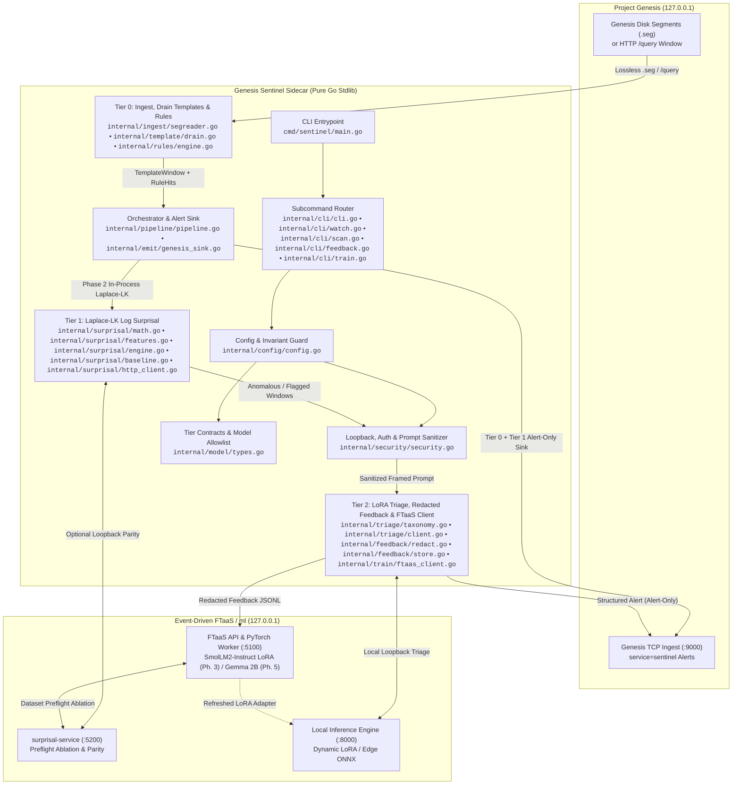
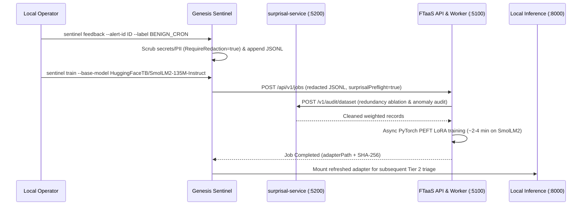

<!-- diagram-meta
last-validated: 2026-11-24
validated-commit: 1a7a213
covers: [cmd/, internal/]
-->

# Genesis Sentinel Architecture Specification (`knowthankyew/genesis-sentinel`)

**Genesis Sentinel** is a standalone, pure-Go standard library sidecar (`go.mod` contains zero external dependencies) that monitors Project Genesis log streams through a three-tier local detection funnel—deterministic rules and template collapsing, Laplace-LK surprisal anomaly scoring, and FTaaS-trained LoRA triage—with zero external network egress.

---

## 1. End-to-End Detection & Feedback Pipeline

---

## 2. Implemented Subsystems (Phases 0–3)

1. **CLI & Configuration Hierarchy (`cmd/sentinel/main.go`, `internal/cli/cli.go`, `internal/cli/watch.go`, `internal/cli/scan.go`, `internal/cli/feedback.go`, `internal/cli/train.go`, `internal/cli/stats.go`, `internal/cli/burn.go`, `internal/config/config.go`):**
   - Mirrors Genesis's single-binary subcommand router (`watch`, `scan`, `feedback`, `train`, `stats`, `burn`, `data`, `config`, `version`, `help`).
   - Merges compiled safe defaults (`DefaultMaxMemMB = <!-- claim:default_max_mem_mb -->256 MB<!-- /claim -->`, `DefaultWindowSec = <!-- claim:default_window_sec -->10s<!-- /claim -->`) -> `sentinel.json` -> `SENTINEL_*` environment variables -> CLI flags.
   - Surfaces Sentinel's local data directory (`~/.genesis-sentinel/` by default) transparently via startup banners and `sentinel data path | status | open` without requiring hidden-folder configuration, and redacts sensitive auth tokens automatically in `sentinel config`.
2. **Domain Contracts & Model Governance (`internal/model/types.go`):**
   - Mirrors Genesis's `parser.LogEntry` JSON contract via `LogEvent`.
   - Defines explicit wire contracts between tiers: `TemplateWindow`, `RuleHit`, `SurprisalScore`, `TriageVerdict`, and `FeedbackRecord`.
   - Enforces a fail-closed base model allowlist (`ValidateBaseModel`): SmolLM2-Instruct (`<!-- claim:default_base_model -->HuggingFaceTB/SmolLM2-135M-Instruct<!-- /claim -->` default, `<!-- claim:stepup_base_model -->HuggingFaceTB/SmolLM2-360M-Instruct<!-- /claim -->` step-up, plus base `SmolLM2-135M`) for Phases 0–4, `<!-- claim:phase5_base_model -->google/gemma-2-2b-it<!-- /claim -->` reserved for Phase 5, and explicit rejection (`ErrExperimentalModelExcluded`) of experimental BitNet models.
3. **Genesis Ingestion Bridge (`internal/ingest/segreader.go`, `internal/ingest/cursor.go`, `internal/ingest/parser.go`, `internal/ingest/querypoller.go`, `internal/ingest/synthetic.go`):**
   - Primary lossless read-only follower for Genesis `--data-dir` length-prefixed IEEE CRC32 `.seg` segments (`MagicHeaderLen = <!-- claim:seg_magic_header_len -->8-byte<!-- /claim -->` header), with atomic cursor persistence (`cursor.json`), rotation handling, partial-write waiting, corrupted-tail recovery, and automatic `genesis burn` rewind detection.
   - Secondary cursor-based HTTP `/query` fallback poller tracking monotonic ID eviction gaps explicitly.
   - Multi-format parser matching Genesis's JSON Lines, Syslog RFC 5424/3164, Pipe, and plain-text parsing, plus a deterministic Track A synthetic attack/noise corpus generator.
4. **Tier 0 Template Collapse & Deterministic Rules (`internal/template/drain.go`, `internal/rules/engine.go`):**
   - Bounded pure-Go Drain-style prefix-tree template collapser (`DefaultMaxClusters = <!-- claim:default_max_clusters -->4,096<!-- /claim -->`, `DefaultMaxClusterBytes = <!-- claim:default_max_cluster_mb -->8 MB<!-- /claim -->`, `DefaultMaxWindows = <!-- claim:default_max_windows -->4,096<!-- /claim -->`, `DefaultMaxRetainedSampleBytes = <!-- claim:default_max_sample_mb -->16 MB<!-- /claim -->`) with fast linear ASCII masking (IPv4, UUID, RFC3339, hex, numeric/duration, path IDs) and peak Shannon entropy tracking across messages and long tokens.
   - Precompiled Go RE2 deterministic rule engine (`rules.json` or built-in starter pack `SENT-001`..`SENT-008`) supporting regex/IOC signatures, burst thresholds, entropy thresholds, and operator allowlist suppressions.
5. **Orchestrator, Alert Sink & Security Layer (`internal/pipeline/pipeline.go`, `internal/emit/genesis_sink.go`, `internal/security/security.go`):**
   - Strict loop-prevention guard dropping incoming `service=sentinel` events before Tier 0 processing.
   - Loopback TCP JSONL alert sink mapping `CRITICAL`/`HIGH` alerts to Genesis `FATAL`/`ERROR` priority lanes, supporting `tier0`, unified `tier0+tier1`, and `tier1` alerts.
   - Constant-time Bearer auth middleware (`crypto/subtle.ConstantTimeCompare`), loopback-only endpoint validation with dial-time IP checks, and untrusted-log sanitizer neutralizing `<|...|>` / `<start_of_turn>` delimiters and flagging prompt-injection cues.
6. **Tier 1 Clean-Room Laplace-LK Log Surprisal Engine (`internal/surprisal/math.go`, `internal/surprisal/features.go`, `internal/surprisal/engine.go`, `internal/surprisal/baseline.go`, `internal/surprisal/http_client.go`):**
   - Pure-Go implementation of Hazard et al. (`arXiv:2510.22809`) Equations 4, 6, 7, and 8 with MAD substitutability floor (`MinDeviationFloor = <!-- claim:surprisal_min_deviation_floor -->0.25<!-- /claim -->`), nominal mismatch penalty (`NominalMismatchNats = <!-- claim:surprisal_nominal_mismatch_nats -->2.5 nats<!-- /claim -->`), cold-start warmup guard (`DefaultWarmupMinCases = <!-- claim:surprisal_default_warmup_cases -->20<!-- /claim -->`), and bounded strided $k$-NN scoring (`DefaultMaxCandidateCases = <!-- claim:surprisal_default_max_candidates -->120<!-- /claim -->`) matching `ml/src/surprisal-service/service.py` within `1e-6` nats.
   - Extracts 8 log-domain continuous features (log token count, log byte length, peak Shannon entropy, scaled symbol/digit/uppercase ratios, log burst count, log inter-arrival ms) and 4 structural nominal features (`service`, `level`, `template_class`, HTTP status family / syslog `<PRI>` facility).
   - Enforces baseline poisoning protection (never absorbs Tier 0 rule hits, prompt-injection events, overflow buckets, or post-warmup anomalies into the rolling baseline), persists atomic `baseline.json` snapshots cleanly wiped by `sentinel burn`, and supports optional loopback `:5200` HTTP/hybrid parity checks.
7. **Tier 2 Local LoRA Triage, Redacted Feedback & FTaaS Training Loop (`internal/triage/taxonomy.go`, `internal/triage/client.go`, `internal/feedback/redact.go`, `internal/feedback/seed.go`, `internal/feedback/store.go`, `internal/feedback/alerts_journal.go`, `internal/train/ftaas_client.go`, `internal/train/adapter_state.go`):**
   - Frames sanitized Tier 0/1 alerts inside explicit `BEGIN_UNTRUSTED_LOG_TELEMETRY` / `END_UNTRUSTED_LOG_TELEMETRY` boundaries and queries local `ml/src/FtaaSService.Inference` (`POST /api/v1/inference/generate`, `DefaultTriageMaxTokens = <!-- claim:triage_default_max_tokens -->64 tokens<!-- /claim -->`) over dial-time loopback HTTP with a generation-tracked circuit breaker and zero-downtime `POST /adapter` hot-swapping.
   - Parses structured bracketed verdicts across the 8 starter security classes (`[BENIGN-NOISE]`, `[RECON-SCAN]`, `[AUTH-BRUTEFORCE]`, `[INJECTION-ATTEMPT]`, `[EXFIL-SUSPECT]`, `[PRIV-ESC]`, `[POLICY-ANOMALY]`, `[NEEDS-REVIEW]`), failing closed to `[NEEDS-REVIEW]` on unstructured outputs and overriding `[BENIGN-NOISE]` back to `[NEEDS-REVIEW]` (`HIGH`) whenever prompt-injection signals were detected on the input log.
   - Records up to `MaxAlertJournalRecords = <!-- claim:feedback_max_alert_journal_records -->2,000<!-- /claim -->` recent alerts in `~/.genesis-sentinel/alerts.jsonl` so `sentinel feedback --alert-id` can curate operator labels (`tp`/`fp`/custom class), scrub PII/secrets (PEM keys, JWTs, Bearer tokens, API keys, credentials, emails, SSA-valid SSNs, Luhn-valid payment cards), generate deterministic synthetic seed splits (`sentinel feedback seed`), and submit audited JSONL jobs to local FTaaS (`POST /api/v1/jobs`, `POST /api/v1/jobs/audit`) via `sentinel train`.

---

## 3. Feedback & Adapter Refresh Sequence (Phase 3 Implemented)

---

## 4. Non-Negotiable Architectural Invariants

1. **Zero External Go Dependencies:** `go.mod` maintains zero `require` directives for the core Sentinel binary.
2. **Localhost-by-Default Zero Egress:** All listeners and upstream service URLs enforce loopback (`127.0.0.1` / `localhost` / `::1`) unless explicitly overridden.
3. **Alert-Only Safety Boundary:** Sentinel classifies, alerts, and explains. It never executes destructive host containment commands from model output.
4. **Loop Prevention:** Sentinel emits alerts back to Genesis under `service=sentinel` (configurable) and strictly drops incoming events from its own alert service before Tier 0 processing.
5. **Claims Are Measured, Not Asserted:** No throughput, latency, memory, or detection-accuracy figures are stated for Sentinel until produced by committed benchmarks in `docs/benchmarks/`.
