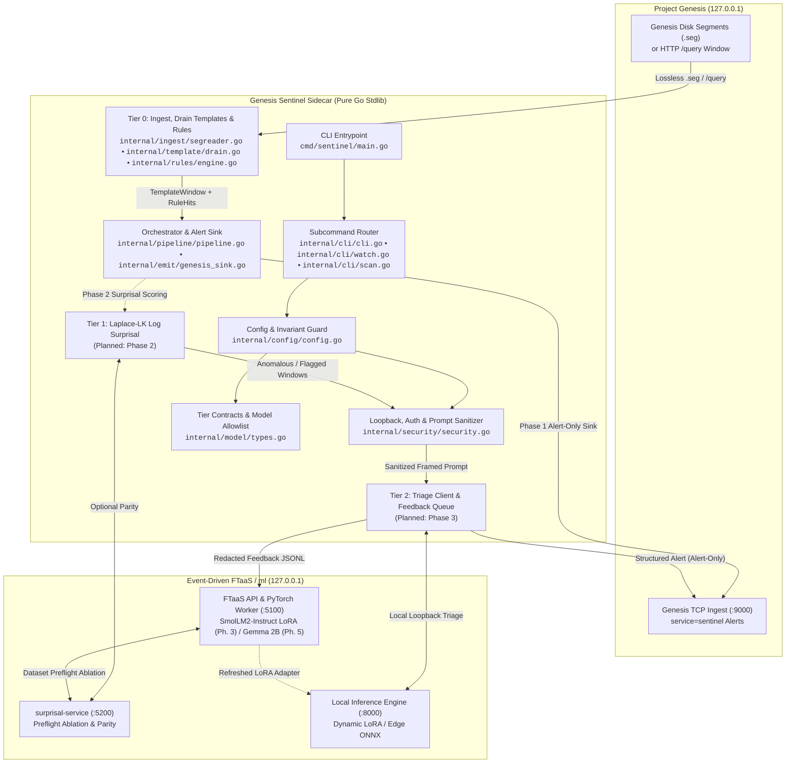
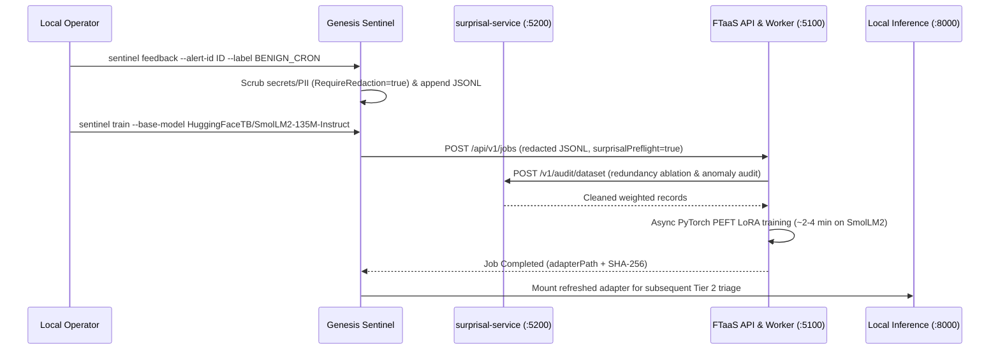

<!-- diagram-meta
last-validated: 2026-11-24
validated-commit: initial-scaffold
covers: [cmd/, internal/]
-->

# Genesis Sentinel Architecture Specification (`knowthankyew/genesis-sentinel`)

**Genesis Sentinel** is a standalone, pure-Go standard library sidecar (`go.mod` contains zero external dependencies) that monitors Project Genesis log streams through a three-tier local detection funnel—deterministic rules and template collapsing, Laplace-LK surprisal anomaly scoring, and FTaaS-trained LoRA triage—with zero external network egress.

---

## 1. End-to-End Detection & Feedback Pipeline

---

## 2. Implemented Subsystems (Phases 0–1)

1. **CLI & Configuration Hierarchy (`cmd/sentinel/main.go`, `internal/cli/cli.go`, `internal/cli/watch.go`, `internal/cli/scan.go`, `internal/cli/stats.go`, `internal/cli/burn.go`, `internal/config/config.go`):**
   - Mirrors Genesis's single-binary subcommand router (`watch`, `scan`, `feedback`, `train`, `stats`, `burn`, `data`, `config`, `version`, `help`).
   - Merges compiled safe defaults -> `sentinel.json` -> `SENTINEL_*` environment variables -> CLI flags.
   - Surfaces Sentinel's local data directory (`~/.genesis-sentinel/` by default) transparently via startup banners and `sentinel data path | status | open` without requiring hidden-folder configuration, and redacts sensitive auth tokens automatically in `sentinel config`.
2. **Domain Contracts & Model Governance (`internal/model/types.go`):**
   - Mirrors Genesis's `parser.LogEntry` JSON contract via `LogEvent`.
   - Defines explicit wire contracts between tiers: `TemplateWindow`, `RuleHit`, `SurprisalScore`, `TriageVerdict`, and `FeedbackRecord`.
   - Enforces a fail-closed base model allowlist (`ValidateBaseModel`): SmolLM2-Instruct (`HuggingFaceTB/SmolLM2-135M-Instruct` default, `SmolLM2-360M-Instruct` step-up, plus base `SmolLM2-135M`) for Phases 0–4, `google/gemma-2-2b-it` reserved for Phase 5, and explicit rejection (`ErrExperimentalModelExcluded`) of experimental BitNet models.
3. **Genesis Ingestion Bridge (`internal/ingest/segreader.go`, `internal/ingest/cursor.go`, `internal/ingest/parser.go`, `internal/ingest/querypoller.go`, `internal/ingest/synthetic.go`):**
   - Primary lossless read-only follower for Genesis `--data-dir` length-prefixed IEEE CRC32 `.seg` segments, with atomic cursor persistence (`cursor.json`), rotation handling, partial-write waiting, corrupted-tail recovery, and automatic `genesis burn` rewind detection.
   - Secondary cursor-based HTTP `/query` fallback poller tracking monotonic ID eviction gaps explicitly.
   - Multi-format parser matching Genesis's JSON Lines, Syslog RFC 5424/3164, Pipe, and plain-text parsing, plus a deterministic Track A synthetic attack/noise corpus generator.
4. **Tier 0 Template Collapse & Deterministic Rules (`internal/template/drain.go`, `internal/rules/engine.go`):**
   - Bounded pure-Go Drain-style prefix-tree template collapser (`DefaultMaxClusters = 4096`) with fast linear ASCII masking (IPv4, UUID, RFC3339, hex, numeric/duration, path IDs) and peak Shannon entropy tracking across messages and long tokens.
   - Precompiled Go RE2 deterministic rule engine (`rules.json` or built-in starter pack `SENT-001`..`SENT-008`) supporting regex/IOC signatures, burst thresholds, entropy thresholds, and operator allowlist suppressions.
5. **Orchestrator, Alert Sink & Security Layer (`internal/pipeline/pipeline.go`, `internal/emit/genesis_sink.go`, `internal/security/security.go`):**
   - Strict loop-prevention guard dropping incoming `service=sentinel` events before Tier 0 processing.
   - Loopback TCP JSONL alert sink mapping `CRITICAL`/`HIGH` alerts to Genesis `FATAL`/`ERROR` priority lanes.
   - Constant-time Bearer auth middleware (`crypto/subtle.ConstantTimeCompare`), loopback-only endpoint validation, and untrusted-log sanitizer neutralizing `<|...|>` / `<start_of_turn>` delimiters and flagging prompt-injection cues.

---

## 3. Feedback & Adapter Refresh Sequence (Phase 3 Target)

---

## 4. Non-Negotiable Architectural Invariants

1. **Zero External Go Dependencies:** `go.mod` maintains zero `require` directives for the core Sentinel binary.
2. **Localhost-by-Default Zero Egress:** All listeners and upstream service URLs enforce loopback (`127.0.0.1` / `localhost` / `::1`) unless explicitly overridden.
3. **Alert-Only Safety Boundary:** Sentinel classifies, alerts, and explains. It never executes destructive host containment commands from model output.
4. **Loop Prevention:** Sentinel emits alerts back to Genesis under `service=sentinel` (configurable) and strictly drops incoming events from its own alert service before Tier 0 processing.
5. **Claims Are Measured, Not Asserted:** No throughput, latency, memory, or detection-accuracy figures are stated for Sentinel until produced by committed benchmarks in `docs/benchmarks/`.
