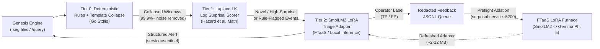

# Genesis Sentinel: Execution Roadmap

> **Repository**: `knowthankyew/genesis-sentinel` (local-first scaffold)  
> **Companion Repositories**: `genesis` (high-throughput Go log engine) &bull; `ml` / `event-driven-ftaas` (FTaaS training furnace & `surprisal-service`)  
> **Active Base Model Tier**: **SmolLM2-Instruct** (`HuggingFaceTB/SmolLM2-135M-Instruct` default; `SmolLM2-360M-Instruct` step-up)  
> **Phase 5 Reasoning Tier**: **Gemma 2 2B IT** (`google/gemma-2-2b-it`)  
> **Explicitly Excluded**: **BitNet b1.58** (experimental; deferred pending upstream development cycle)  
> **Status**: 🟢 **PHASE 0 COMPLETE** | 🟡 **PHASE 1 NEXT**  
> **Date**: 2026-11-24

---

## 1. Mission & Design Premise

**Genesis Sentinel** is a local-first, zero-egress security triage and anomaly detection sidecar for Project Genesis. Like a classic host antivirus or local intrusion detection engine, it watches local telemetry streams for malicious activity, anomalous bursts, and operator-defined "interesting traffic"—and learns host-specific signal vs. noise through periodic **FTaaS LoRA adapter updates**.

Because raw log volume in Genesis can reach over one million lines per second while local LLM inference executes at a few completions per second, Sentinel uses a **three-tier funnel** rather than sending raw log lines directly to a language model:

---

## 2. Phase Overview

| Phase | Milestone | Primary Deliverables | Target Model Tier | Status |
| :--- | :--- | :--- | :--- | :--- |
| **Phase 0** | **Scaffold & Governance** | Local Git repo, pure-Go stdlib scaffold, domain contracts, loopback & prompt-injection guards, ADRs, Architecture Spec, Roadmap | Contract-only (`SmolLM2` default) | 🟢 **Completed** |
| **Phase 1** | **Genesis Bridge & Tier 0** | Lossless `.seg` CRC32 tailer + `/query` sliding-window reader, Drain-style template collapser, JSON deterministic rule/IOC engine, Genesis alert sink (`service=sentinel`), `sentinel burn` | None (Pure Go) | ⬜ Planned |
| **Phase 2** | **Tier 1 Surprisal Engine** | Log-domain feature extractor + Laplace-LK surprisal scorer (in-process Go engine + optional `surprisal-service` HTTP parity mode), rolling baseline manager, anomaly threshold calibration | None (Information-Theoretic Math) | ⬜ Planned |
| **Phase 3** | **Tier 2 SmolLM2 Triage & FTaaS Loop** | Curated log triage dataset generator (synthetic + redacted local baselines), FTaaS training integration (`max_length` tuning in `ml`), `sentinel feedback` & `sentinel train`, local SmolLM2 inference client (HTTP / ONNX) | **SmolLM2-135M** (or `SmolLM2-135M-Instruct`) | ⬜ Planned |
| **Phase 4** | **Hardening, Benchmarks & Ops** | Hostile-log prompt-injection test harness, live replay benchmark (`cmd/sentinel-bench`), empirical metrics & claims audit (`scripts/audit-claims.py`), `launchd`/`systemd` units, optional `all-MiniLM-L6-v2` comparison | SmolLM2 | ⬜ Planned |
| **Phase 5** | **Gemma 2 2B IT Upgrade** | High-capacity reasoning adapter training on `google/gemma-2-2b-it`, tiered Smol-to-Gemma escalation for high-severity incidents, side-by-side quality vs. latency benchmark report | **Gemma 2 2B IT** | ⬜ Deferred to End |

---

## 3. Detailed Phase Specifications

### Phase 0: Repository Scaffold & Architectural Decisions (Completed)
- **Deliverables**:
  - Local Git repository (`genesis-sentinel`) adhering strictly to Genesis coding and privacy standards: pure Go 1.24+ standard library (`go.mod` has zero external dependencies), JSON/env/flag config hierarchy, MIT license, `NOTICE.md`, `SECURITY.md`, `CONTRIBUTING.md`.
  - Core domain contracts in `internal/model/types.go` (`LogEvent`, `TemplateWindow`, `RuleHit`, `SurprisalScore`, `TriageVerdict`, `FeedbackRecord`).
  - Security foundations in `internal/security/security.go`: constant-time Bearer auth middleware, loopback-only endpoint validation, and untrusted-log control-token & prompt-injection sanitizer.
  - Explicit fail-closed model allowlist enforcing Smol-first development, Phase 5 Gemma readiness, and exclusion of experimental BitNet models.
- **Exit Gate**: `make build && make test && make race && make lint` pass cleanly with zero external Go dependencies.

---

### Phase 1: Genesis Bridge & Tier 0 Deterministic Engine
- **Goal**: Ingest Genesis logs losslessly via `.seg` file tailing, surface all local disk paths transparently to the operator, and collapse repetitive noise before statistical or ML scoring.
- **Starter Log Target Tracks (Locked In)**:
  - **Track A (Synthetic Attack & Noise Replay Corpus):** Deterministic generator emitting normal web/cron/system noise interleaved with realistic SSH brute-force, HTTP SQLi/path-traversal/scanner probes, high-entropy DNS/outbound exfil bursts, and `sudo`/privilege-escalation anomalies—giving reproducible CI tests and Phase 4 benchmarks.
  - **Track B (Live Local Host & Container Logs):** macOS host telemetry (`log stream` / auth / SSH) and local Docker Compose / HTTP service logs piped into Genesis (`genesis run` / `genesis pipe`).
- **Deliverables**:
  - `internal/ingest/segreader.go`: **Primary** read-only follower for Genesis `--data-dir` length-prefixed CRC32 `.seg` files with persisted read cursor (`~/.genesis-sentinel/cursor.json`), handling segment rotation, torn-tail recovery, and `genesis burn` unlinks cleanly.
  - `internal/ingest/querypoller.go`: Secondary cursor-based `/query` fallback reader for volatile-mode Genesis instances (tracking eviction gaps explicitly in metrics).
  - `internal/template/drain.go`: Fast pure-Go Drain-style log template miner masking dynamic tokens (IPv4/IPv6, UUIDs, hex blobs, paths with IDs, timestamps, numeric ports) and aggregating identical lines into `TemplateWindow` summaries with Shannon entropy measurements.
  - `internal/rules/engine.go`: Deterministic JSON-defined rule engine supporting regex/substring IOCs, severity escalation, rate-burst thresholds (e.g., >N SSH failures / 10s), and allowlist suppressions, shipped with starter rules for Track A/B logs.
  - `internal/emit/genesis_sink.go`: Loopback TCP/pipe emitter writing structured Sentinel alert events back into Genesis under `service=sentinel` (with loop-prevention guard ignoring incoming `service=sentinel` lines).
  - `sentinel watch`, `sentinel scan`, `sentinel stats`, and `sentinel burn` CLI commands (completing full disk cleanup paired with the Phase 0 `sentinel data path|status|open` commands so operators never hunt for hidden folders).
- **Exit Gate**:
  - Replays 100,000+ Track A synthetic mixed logs through `.seg` tailing + Tier 0 with measured throughput, memory plateau, and collapse ratio recorded.
  - Zero infinite alert feedback loops (`service=sentinel` strictly ignored on ingest).
  - `go test -race ./...` passes with zero races.

---

### Phase 2: Tier 1 Laplace-LK Log Surprisal Engine
- **Goal**: Catch novel, previously unseen, or subtly weird log patterns—even without matching a static rule or a labeled training example—using the information-theoretic Laplace-LK surprisal mathematics from `ml/src/surprisal-service` (Hazard et al., `arXiv:2510.22809`, Equations 4, 6, 7, 8).
- **Deliverables**:
  - `internal/surprisal/features.go`: Log-domain feature extractor replacing the fintech/SaaS keywords in `ml/src/surprisal-service/service.py` with security & telemetry features:
    - Continuous features: template token count, raw byte length, Shannon byte entropy, punctuation/symbol ratio, burst count per window, inter-arrival delta, digit ratio, uppercase ratio.
    - Nominal features: `service`, `level`, `template_id` novelty class, HTTP status family / syslog facility (when present).
  - `internal/surprisal/engine.go`: Pure-Go Laplace-LK rolling-baseline scorer computing MAD substitutability deviations ($\delta$), Lukaszyk-Karmowski expected distances, marginal nats per feature, and total joint surprisal in nats.
  - `internal/surprisal/http_client.go`: Optional HTTP client mode (`surprisal_mode=http` or `hybrid`) to delegate scoring or cross-check parity against `ml/src/surprisal-service` on `127.0.0.1:5200` (paired with adding a log-feature profile endpoint to `surprisal-service` in `ml`).
  - Rolling baseline persistence (opt-in local snapshot, wiped atomically by `sentinel burn`) plus cold-start warmup guard (no alert storm during initial baseline learning).
- **Exit Gate**:
  - Unit tests verifying numerical parity between Go Laplace-LK equations and `ml/src/surprisal-service/service.py` within $10^{-6}$ nats on identical numeric vectors.
  - Replay benchmark demonstrating high surprisal separation between baseline normal traffic and injected anomalous traffic (unseen commands, high-entropy exfil payloads, sudden service/level shifts) with bounded false-positive rate.

---

### Phase 3: Tier 2 SmolLM2 LoRA Triage & FTaaS Feedback Loop
- **Goal**: Prove the entire "train an adapter on curated host logs → run lightweight local triage → refine with operator feedback" loop quickly on **SmolLM2** before investing compute in larger models.
- **Deliverables**:
  - **Starter Security Triage Taxonomy & Synthetic Seed Dataset**: Structured `prompt -> completion` JSONL schema covering common classes (`[BENIGN-NOISE]`, `[RECON-SCAN]`, `[AUTH-BRUTEFORCE]`, `[INJECTION-ATTEMPT]`, `[EXFIL-SUSPECT]`, `[PRIV-ESC]`, `[POLICY-ANOMALY]`, `[NEEDS-REVIEW]`).
  - **Small Coordination Updates in `ml` (FTaaS)**:
    - Make `max_length` configurable in `ml/src/FtaaSService.Worker/trainer.py` (currently hardcoded to `256` tokens; `512`–`1024` tokens is needed for multi-line log windows + structured explanations).
    - Optionally register `HuggingFaceTB/SmolLM2-135M-Instruct` (or `SmolLM2-360M-Instruct`) in `ml/src/FtaaSService.Worker/model_registry.py` and the .NET allowlist if selected over base `SmolLM2-135M`.
    - Add a log-domain feature profile (or generic feature mode) to `ml/src/surprisal-service/service.py` so FTaaS preflight redundancy ablation works accurately on log triage datasets without fintech keywords.
  - `internal/triage/client.go`: Loopback HTTP client sending sanitized, framed `TemplateWindow` + `SurprisalScore` prompts to `ml`'s inference engine (`127.0.0.1:8000`) or a local ONNX runtime wrapper, parsing structured verdict tags safely with fail-closed fallback to `[NEEDS-REVIEW]`.
  - `internal/feedback/store.go`: `sentinel feedback` workflow allowing the operator to label alerts (`tp` / `fp` / custom class), enforcing mandatory redaction + Luhn/PII screening before writing FTaaS-compatible JSONL datasets (respecting FTaaS's 25 MB / 50,000-record ceilings).
  - `internal/train/ftaas_client.go`: `sentinel train` command uploading curated redacted JSONL to `POST http://127.0.0.1:5100/api/v1/jobs` with `enableSurprisalPreflight=true` and `baseModel=HuggingFaceTB/SmolLM2-135M` (or chosen Smol variant), polling status, and activating the resulting adapter.
- **Exit Gate**:
  - End-to-end live run: Genesis synthetic logs → Tier 0 collapse → Tier 1 surprisal spike → Tier 2 SmolLM2 LoRA verdict → Alert visible in Genesis UI → Operator feedback → FTaaS LoRA retrain (~2–4 min on local hardware) → Improved verdict on holdout test set.

---

### Phase 4: Security Hardening, Empirical Benchmarks & Operational Polish
- **Goal**: Bring `genesis-sentinel` up to Genesis's full production-verification rigor ("claims are measured, not asserted").
- **Deliverables**:
  - **Adversarial Hostile-Log Test Suite**: Automated tests verifying chat-template escape neutralization, semantic prompt-injection flagging (`injection_suspected=true`), log-flood resilience (no silent drops in `.seg` mode), and PII/secret redaction before training export.
  - **Replay Benchmark Harness (`cmd/sentinel-bench`)**: Reproducible benchmark measuring Tier 0 throughput, Tier 1 surprisal latency, Tier 2 Smol triage latency, RSS memory footprint, and detection precision/recall on synthetic attack scenarios, committed under `docs/benchmarks/`.
  - **Claims & Governance Linter (`scripts/audit-claims.py`)**: Porting Genesis's fail-closed zero-dep, MIT/SPDX, diagram-freshness, and empirical-claims checks.
  - **Optional Semantic Embedding Evaluation**: Offline experiment comparing pure Laplace-LK log features against combining them with the already-cached `sentence-transformers/all-MiniLM-L6-v2` (~90 MB RAM) to measure whether semantic embeddings meaningfully improve recall on disguised payloads.
  - **Service Units**: macOS `launchd` plist and Linux `systemd` unit files under `deploy/`.
- **Exit Gate**: Committed empirical benchmark report and clean pass across unit, race, adversarial, and claims-audit gates.

---

### Phase 5: Gemma 2 2B IT Reasoning-Tier Upgrade
- **Goal**: Graduate the proven SmolLM2 architecture to higher-capacity reasoning without changing upstream Tier 0, Tier 1, or feedback contracts.
- **Deliverables**:
  - Train a `google/gemma-2-2b-it` LoRA adapter through FTaaS using the exact same curated JSONL datasets accumulated during Phases 3–4 (weights are already cached locally in `~/.cache/huggingface/hub/models--google--gemma-2-2b-it`).
  - **Optional Escalation Routing**: Keep SmolLM2 handling routine Tier 2 triage (~310 MB RAM) and escalate only `HIGH`/`CRITICAL` alerts or multi-window correlation requests to `Gemma 2 2B IT` on demand (keeping steady-state RAM comfortable on 16 GB hosts).
  - Comparative benchmark report (`SmolLM2` vs `Gemma 2 2B IT`) measuring triage accuracy, explanation quality, false-positive reduction, memory footprint, and latency per incident.
- **Exit Gate**: Side-by-side empirical comparison committed under `docs/benchmarks/` demonstrating measurable triage improvement justifying Gemma's memory/latency footprint for escalation use cases.

---

## 4. Explicitly Excluded & Deferred Items

- **BitNet b1.58 (`microsoft/BitNet-b1.58-2B-4T` & `bitnet-embedding-270m`)**: Explicitly excluded from Phases 0–5 (and rejected fail-closed by `internal/model.ValidateBaseModel`). BitNet remains an experimental research track in `ml` awaiting an upstream development cycle to resolve generation context caps (`MAX_SAFE_GENERATE_TOKENS = 16`), native GGUF LoRA adapter conversion/serving, and `float32` MPS training bottlenecks. Re-evaluation requires a future ADR after upstream updates land.
- **Autonomous Destructive Response (Firewall Blocking / Process Killing)**: Out of scope. Because logs are untrusted attacker-influenced input, Sentinel operates strictly in **alert, classify, and explain** mode to prevent denial-of-service via spoofed log lines or prompt injection.
- **Cloud / External API Egress**: Out of scope by default. All ingestion, surprisal scoring, FTaaS training, and inference run over loopback (`127.0.0.1`).

---

## 5. Local Model Inventory & Recommendation

Based on a scan of the local Hugging Face cache (`~/.cache/huggingface/hub`):

| Model | Local Cache Status | Approx. Size / RAM | Recommendation for Sentinel |
| :--- | :--- | :--- | :--- |
| **`HuggingFaceTB/SmolLM2-135M`** | ✅ Cached locally | ~270 MB / ~310 MB RAM | **Ready immediately (zero download, already registered in `ml`).** Note: this is the *base* (non-instruct) checkpoint—works well once LoRA-tuned on tight structured prompts, though base completions ramble before fine-tuning. |
| **`HuggingFaceTB/SmolLM2-135M-Instruct`** | ⬜ Not cached | ~270 MB / ~310 MB RAM | **Recommended optional pull for Phase 3.** Same speed & Apache 2.0 license as base 135M, but instruction-tuned with ChatML so zero-shot triage, JSON/tag adherence, and base-vs-tuned comparisons are noticeably cleaner. |
| **`HuggingFaceTB/SmolLM2-360M-Instruct`** | ⬜ Not cached | ~720 MB / ~800 MB RAM | **Strong middle-ground option** if 135M struggles with multi-line log syntax (HTTP/SQL/shell obfuscation) before jumping to Gemma 2B. |
| **`google/gemma-2-2b-it`** | ✅ Cached locally | ~5.2 GB / ~5.6 GB CPU RAM | **Ready for Phase 5.** Hold until the full pipeline and datasets are proven on Smol. |
| **`sentence-transformers/all-MiniLM-L6-v2`** | ✅ Cached locally | ~90 MB RAM | **Optional Phase 4 experiment** for semantic template novelty alongside Laplace-LK surprisal. |
| **`microsoft/BitNet-*`** | ✅ Cached locally | — | **Excluded** per ADR-5 (experimental). |

---

## 6. Locked-In Operator Decisions (Pre-Phase 1)

All four architectural decision points are finalized for Phase 1–5 execution:

1. **Smol Instruct Models (ADR-5):** Default to **`HuggingFaceTB/SmolLM2-135M-Instruct`** (~270 MB) with **`HuggingFaceTB/SmolLM2-360M-Instruct`** (~720 MB) pulled locally as the optional Smol step-up; both will be registered in `ml`'s model catalog during Phase 3. `google/gemma-2-2b-it` remains reserved for Phase 5; BitNet remains excluded.
2. **Starter Log Sources (Phase 1):** Dual-track baseline—**Track A** synthetic deterministic attack/noise replay corpus (SSH brute-force, HTTP SQLi/traversal/scanners, DNS/exfil entropy spikes, privilege-escalation anomalies) + **Track B** live macOS host & local Docker/HTTP logs piped into Genesis.
3. **Performance-First Online Surprisal (ADR-7):** Prioritize raw per-template throughput via an **in-process pure-Go Laplace-LK engine** (`surprisal_mode="inprocess"` default, avoiding HTTP/JSON/Python GIL overhead on the hot path), paired with cross-repo numerical parity tests and `ml`'s containerized `surprisal-service` (`:5200`) for offline FTaaS training dataset preflight ablation.
4. **Disk-Backed `.seg` Tailing & Portfolio Pillar Variance (ADR-4):** Start with lossless `.seg` file tailing and bounded local state in `~/.genesis-sentinel/`. This **intentional variance from Portfolio Pillar 1 (volatile-memory-only default)** is documented transparently in `README.md`, `NOTICE.md`, `SECURITY.md`, and `docs/DECISIONS.md`, and paired with first-class operator ergonomics (`sentinel data path`, `sentinel data status`, `sentinel data open`, and `sentinel burn`) so users never need to memorize hidden paths or toggle hidden folders.
