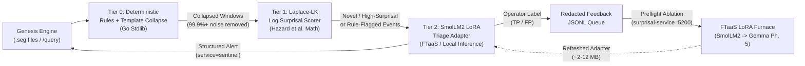

# Genesis Sentinel: Execution Roadmap

> **Repository**: `knowthankyew/genesis-sentinel` (local-first scaffold)  
> **Companion Repositories**: `genesis` (high-throughput Go log engine) &bull; `ml` / `event-driven-ftaas` (FTaaS training furnace & `surprisal-service`)  
> **Active Base Model Tier**: **SmolLM2-Instruct** (`HuggingFaceTB/SmolLM2-135M-Instruct` default; `SmolLM2-360M-Instruct` step-up)  
> **Phase 5 Reasoning Tier**: **Gemma 2 2B IT** (`google/gemma-2-2b-it`)  
> **Explicitly Excluded**: **BitNet b1.58** (experimental; deferred pending upstream development cycle)  
> **Status**: 🟢 **PHASES 0–5 COMPLETE** (SmolLM2-135M + Gemma 2 2B IT Hybrid Escalation & Hot-Swap) &bull; 🧭 **PHASES 6–7 PLANNED** (Real-World Corpus Hardening → Developer & Power-User Legibility)  
> **Date**: 2026-11-27

---

## 1. Mission & Design Premise

**Genesis Sentinel** is a local-first, zero-egress security triage and anomaly detection sidecar for Project Genesis. Like a classic host antivirus or local intrusion detection engine, it watches local telemetry streams for malicious activity, anomalous bursts, and operator-defined "interesting traffic"—and learns host-specific signal vs. noise through periodic **FTaaS LoRA adapter updates**.

Because raw log volume in Genesis can reach over one million lines per second while local LLM inference executes at a few completions per second, Sentinel uses a **three-tier funnel** rather than sending raw log lines directly to a language model:

---

## 2. Phase Overview

| Phase | Milestone | Primary Deliverables | Target Model Tier | Status |
| :--- | :--- | :--- | :--- | :--- |
| **Phase 0** | **Scaffold & Governance** | Local Git repo, pure-Go stdlib scaffold, domain contracts, loopback & prompt-injection guards, ADRs, Architecture Spec, Roadmap | Contract-only (`SmolLM2` default) | 🟢 **Completed** |
| **Phase 1** | **Genesis Bridge & Tier 0** | Lossless `.seg` CRC32 tailer + `/query` sliding-window reader, Drain-style template collapser, JSON deterministic rule/IOC engine, Genesis alert sink (`service=sentinel`), `watch`/`scan`/`stats`/`burn` | None (Pure Go) | 🟢 **Completed** |
| **Phase 2** | **Tier 1 Surprisal Engine** | Log-domain feature extractor + Laplace-LK surprisal scorer (in-process Go engine + optional `surprisal-service` HTTP parity mode), rolling baseline manager, anomaly threshold calibration | None (Information-Theoretic Math) | 🟢 **Completed** |
| **Phase 3** | **Tier 2 SmolLM2 Triage & FTaaS Loop** | Curated log triage dataset generator (synthetic + redacted local baselines), `internal/triage` loopback LoRA client & fail-closed parser, `sentinel feedback` & `sentinel train`, `POST /adapter` live hot-swap (plus companion updates in `ml`) | **SmolLM2-135M-Instruct** (`360M-Instruct` step-up) | 🟢 **Completed** |
| **Phase 4** | **Hardening, Benchmarks & Ops** | Hostile-log prompt-injection test harness, live replay benchmark (`cmd/sentinel-bench`), empirical metrics & claims audit (`scripts/audit-claims.py`), `launchd`/`systemd`/Compose units, offline `all-MiniLM-L6-v2` comparison | SmolLM2 | 🟢 **Completed** |
| **Phase 5** | **Gemma 2 2B IT Upgrade** | High-capacity reasoning adapter training on `google/gemma-2-2b-it`, tiered Smol-to-Gemma escalation for high-severity incidents, side-by-side quality vs. latency benchmark report, live dual-slot hot-swap | **Gemma 2 2B IT** | 🟢 **Completed** |
| **Phase 6** | **Real-World Corpus Hardening & Quantized Tier 2** | Messy public log corpus benchmarks (LogHub + live macOS Unified Logs), Drain/Laplace-LK field tuning, explicit `reasoning_deferred` backpressure & "Never Output 'All Clear'" summaries, quantized loopback Tier 2 adapter (GGUF / MLX) | **Quantized Gemma 2 2B IT / SmolLM2** | 🧭 **Planned** |
| **Phase 7** | **Developer & Power-User Legibility** | Embedded zero-CDN `sentinel ui` briefing surface (Proof-of-Work receipt, ranked narrative threads, 1-click `TP`/`FP` feedback), forkable JSON starter "lenses" (`macos-workstation`, `docker-dev`, `homelab-ssh`), redacted incident export (`sentinel export`) | **SmolLM2 + Quantized Gemma 2B** | 🧭 **Planned** |

---

## 3. Detailed Phase Specifications

### Phase 0: Repository Scaffold & Architectural Decisions (Completed)
- **Deliverables**:
  - Local Git repository (`genesis-sentinel`) adhering strictly to Genesis coding and privacy standards: pure Go 1.24+ standard library (`go.mod` has zero external dependencies), JSON/env/flag config hierarchy, MIT license, `NOTICE.md`, `SECURITY.md`, `CONTRIBUTING.md`.
  - Core domain contracts in `internal/model/types.go` (`LogEvent`, `TemplateWindow`, `RuleHit`, `SurprisalScore`, `TriageVerdict`, `FeedbackRecord`).
  - Security foundations in `internal/security/security.go`: constant-time Bearer auth middleware, loopback-only endpoint validation, and untrusted-log control-token & prompt-injection sanitizer.
  - Explicit fail-closed model allowlist enforcing Smol-first development, Phase 5 Gemma readiness, and exclusion of experimental BitNet models.
- **Exit Gate**: `make build && make test && make race && make lint` pass cleanly with zero external Go dependencies.

---

### Phase 1: Genesis Bridge & Tier 0 Deterministic Engine (Completed)
- **Goal**: Ingest Genesis logs losslessly via `.seg` file tailing, surface all local disk paths transparently to the operator, and collapse repetitive noise before statistical or ML scoring.
- **Starter Log Target Tracks (Locked In)**:
  - **Track A (Synthetic Attack & Noise Replay Corpus):** Deterministic generator emitting normal web/cron/system noise interleaved with realistic SSH brute-force, HTTP SQLi/path-traversal/scanner probes, high-entropy DNS/outbound exfil bursts, and `sudo`/privilege-escalation anomalies—giving reproducible CI tests and Phase 4 benchmarks.
  - **Track B (Live Local Host & Container Logs):** macOS host telemetry (`log stream` / auth / SSH) and local Docker Compose / HTTP service logs piped into Genesis (`genesis run` / `genesis pipe`).
- **Deliverables**:
  - `internal/ingest/segreader.go`: **Primary** read-only follower for Genesis `--data-dir` length-prefixed CRC32 `.seg` files with persisted read cursor (`~/.genesis-sentinel/cursor.json`), handling segment rotation, torn-tail recovery, and `genesis burn` unlinks cleanly.
  - `internal/ingest/querypoller.go`: Secondary cursor-based `/query` fallback reader for volatile-mode Genesis instances (tracking eviction gaps explicitly in metrics).
  - `internal/template/drain.go`: Fast pure-Go Drain-style log template miner masking dynamic tokens (IPv4/IPv6, UUIDs, hex blobs, paths with IDs, timestamps, numeric ports) and aggregating identical lines into `TemplateWindow` summaries with Shannon entropy measurements.
  - `internal/rules/engine.go`: Deterministic JSON-defined rule engine supporting regex/substring IOCs, severity escalation, rate-burst thresholds (e.g., >N SSH failures / 10s), and allowlist suppressions, shipped with starter rules for Track A/B logs.
  - `internal/emit/genesis_sink.go`: Loopback TCP/pipe emitter writing structured Sentinel alert events back into Genesis under `service=sentinel` (with loop-prevention guard ignoring incoming `service=sentinel` lines).
  - `sentinel watch`, `sentinel scan`, `sentinel stats`, and `sentinel burn` CLI commands (completing full disk cleanup paired with the Phase 0 `sentinel data path|status|open` commands so operators never hunt for hidden folders).
- **Exit Gate**:
  - Replays 100,000+ Track A synthetic mixed logs through `.seg` tailing + Tier 0 with measured throughput, memory plateau, and collapse ratio recorded.
  - Zero infinite alert feedback loops (`service=sentinel` strictly ignored on ingest).
  - `go test -race ./...` passes with zero races.

---

### Phase 2: Tier 1 Laplace-LK Log Surprisal Engine (Completed)
- **Goal**: Catch novel, previously unseen, or subtly weird log patterns—even without matching a static rule or a labeled training example—using the information-theoretic Laplace-LK surprisal mathematics from `ml/src/surprisal-service` (Hazard et al., `arXiv:2510.22809`, Equations 4, 6, 7, 8).
- **Deliverables**:
  - `internal/surprisal/features.go`: Log-domain feature extractor replacing the fintech/SaaS keywords in `ml/src/surprisal-service/service.py` with security & telemetry features:
    - Continuous features: template token count, raw byte length, Shannon byte entropy, punctuation/symbol ratio, burst count per window, inter-arrival delta, digit ratio, uppercase ratio.
    - Nominal features: `service`, `level`, `template_id` novelty class, HTTP status family / syslog facility (when present).
  - `internal/surprisal/engine.go`: Pure-Go Laplace-LK rolling-baseline scorer computing MAD substitutability deviations ($\delta$), Lukaszyk-Karmowski expected distances, marginal nats per feature, and total joint surprisal in nats.
  - `internal/surprisal/http_client.go`: Optional HTTP client mode (`surprisal_mode=http` or `hybrid`) to delegate scoring or cross-check parity against `ml/src/surprisal-service` on `127.0.0.1:5200` (paired with adding a log-feature profile endpoint to `surprisal-service` in `ml`).
  - Rolling baseline persistence (opt-in local snapshot, wiped atomically by `sentinel burn`) plus cold-start warmup guard (no alert storm during initial baseline learning).
- **Exit Gate**:
  - Unit tests verifying numerical parity between Go Laplace-LK equations and `ml/src/surprisal-service/service.py` within $10^{-6}$ nats on identical numeric vectors.
  - Replay benchmark demonstrating high surprisal separation between baseline normal traffic and injected anomalous traffic (unseen commands, high-entropy exfil payloads, sudden service/level shifts) with bounded false-positive rate.

---

### Phase 3: Tier 2 SmolLM2 LoRA Triage & FTaaS Feedback Loop (Completed — Sentinel Core)
- **Goal**: Prove the entire "train an adapter on curated host logs → run lightweight local triage → refine with operator feedback" loop quickly on **SmolLM2** before investing compute in larger models.
- **Deliverables**:
  - **Starter Security Triage Taxonomy & Synthetic Seed Dataset**: Structured `prompt -> completion` JSONL schema covering common classes (`[BENIGN-NOISE]`, `[RECON-SCAN]`, `[AUTH-BRUTEFORCE]`, `[INJECTION-ATTEMPT]`, `[EXFIL-SUSPECT]`, `[PRIV-ESC]`, `[POLICY-ANOMALY]`, `[NEEDS-REVIEW]`).
  - **Small Coordination Updates in `ml` (FTaaS)**:
    - Make `max_length` configurable in `ml/src/FtaaSService.Worker/trainer.py` (currently hardcoded to `256` tokens; `512`–`1024` tokens is needed for multi-line log windows + structured explanations).
    - Optionally register `HuggingFaceTB/SmolLM2-135M-Instruct` (or `SmolLM2-360M-Instruct`) in `ml/src/FtaaSService.Worker/model_registry.py` and the .NET allowlist if selected over base `SmolLM2-135M`.
    - Add a log-domain feature profile (or generic feature mode) to `ml/src/surprisal-service/service.py` so FTaaS preflight redundancy ablation works accurately on log triage datasets without fintech keywords.
  - `internal/triage/client.go`: Loopback HTTP client sending sanitized, framed `TemplateWindow` + `SurprisalScore` prompts to `ml`'s inference engine (`127.0.0.1:8000`) or a local ONNX runtime wrapper, parsing structured verdict tags safely with fail-closed fallback to `[NEEDS-REVIEW]`.
  - `internal/feedback/store.go`: `sentinel feedback` workflow allowing the operator to label alerts (`tp` / `fp` / custom class), enforcing mandatory redaction + Luhn/PII screening before writing FTaaS-compatible JSONL datasets (respecting FTaaS's <!-- claim:default_max_training_file_mb -->25 MB<!-- /claim --> / <!-- claim:default_max_training_records -->50,000<!-- /claim -->-record ceilings).
  - `internal/train/ftaas_client.go`: `sentinel train` command uploading curated redacted JSONL to `POST http://127.0.0.1:5100/api/v1/jobs` with `enableSurprisalPreflight=true` and `baseModel=HuggingFaceTB/SmolLM2-135M` (or chosen Smol variant), polling status, and activating the resulting adapter.
- **Exit Gate**:
  - End-to-end live run: Genesis synthetic logs → Tier 0 collapse → Tier 1 surprisal spike → Tier 2 SmolLM2 LoRA verdict → Alert visible in Genesis UI → Operator feedback → FTaaS LoRA retrain (~2–4 min on local hardware) → Improved verdict on holdout test set.

---

### Phase 4: Security Hardening, Empirical Benchmarks & Operational Polish (Completed)
- **Goal**: Bring `genesis-sentinel` up to Genesis's full production-verification rigor ("claims are measured, not asserted").
- **Deliverables**:
  - **Adversarial Hostile-Log Test Suite**: Automated tests verifying chat-template escape neutralization, semantic prompt-injection flagging (`injection_suspected=true`), log-flood resilience (no silent drops in `.seg` mode), and PII/secret redaction before training export.
  - **Replay Benchmark Harness (`cmd/sentinel-bench`)**: Reproducible benchmark measuring Tier 0 throughput, Tier 1 surprisal latency, Tier 2 Smol triage latency, RSS memory footprint, and detection precision/recall on synthetic attack scenarios, committed under `docs/benchmarks/`.
  - **Claims & Governance Linter (`scripts/audit-claims.py`):** Baseline zero-dep, MIT/SPDX, Go constant claims (`docs/claims_registry.json`), diagram freshness, CycloneDX 1.5 SBOM (`bom.json`), and CI + SLSA attestation were pulled forward into the Phase 1 governance gate; Phase 4 extends `scripts/sync_docs.py` and `scripts/audit-claims.py` with independent mathematical recomputation over committed `docs/benchmarks/empirical_benchmarks.json`.
  - **Optional Semantic Embedding Evaluation**: Offline experiment comparing pure Laplace-LK log features against combining them with the already-cached `sentence-transformers/all-MiniLM-L6-v2` (~90 MB RAM) to measure whether semantic embeddings meaningfully improve recall on disguised payloads.
  - **Service Units**: macOS `launchd` plist and Linux `systemd` unit files under `deploy/`.
- **Exit Gate**: Committed empirical benchmark report and clean pass across unit, race, adversarial, and claims-audit gates.

---

### Phase 5: Gemma 2 2B IT Reasoning-Tier Upgrade & Live Dual-Slot Hot-Swap (Completed)
- **Goal**: Graduate the proven SmolLM2 architecture to higher-capacity reasoning without changing upstream Tier 0, Tier 1, or feedback contracts.
- **Deliverables**:
  - Trained and evaluated real local `google/gemma-2-2b-it` and `SmolLM2-135M-Instruct` LoRA adapters offline using the curated Sentinel security triage dataset structure (`scripts/eval_phase5_models.py`, cached local Hugging Face weights).
  - **Selective Escalation Routing & Multi-Window Correlation (`internal/pipeline/adapter_hotswap.go`, `internal/config/config.go`):** Keeps SmolLM2 handling routine Tier 2 triage (`:8000`) while escalating `HIGH`/`CRITICAL`, injection-flagged, `NEEDS-REVIEW`, primary-fallback, or multi-window correlated alerts (`serviceCorrelator`, 600s TTL) to `google/gemma-2-2b-it` (`:8001`) on demand (`high_critical`, `strict`, `always` policies).
  - **Live Zero-Downtime Adapter Hot-Swap (`internal/train/adapter_state.go`, `internal/cli/adapter.go`):** Upgraded `/adapter` (`GET`/`POST`/`DELETE`) and `active-adapter.json` to dual-slot tracking with automatic rollback snapshots, `/healthz` base-model preflight verification (`--verify`), dynamic slot activation (`--enable`), periodic disk auto-reload (`auto_reload_adapter`), and the `sentinel adapter` CLI (`status`, `swap`, `rollback`, `deactivate`, `history`).
  - Comparative benchmark report (`SmolLM2` vs `Gemma 2 2B IT` + hybrid selective escalation + live hot-swap latency) committed under `docs/benchmarks/`.
- **Exit Gate**: Side-by-side empirical comparison committed under `docs/benchmarks/` (`docs/benchmarks/phase5_gemma_comparison.json` & `docs/benchmarks/2026-11-26-phase5-comparison.md`), refreshed `empirical_benchmarks.json`, and clean pass across unit, race, adversarial, SBOM, and claims-audit gates.

---

### Phase 6: Real-World Corpus Hardening, Backpressure Honesty & Quantized Local Tier 2 (`v0.7.0-phase6` — Planned)
- **Goal**: Move Sentinel from clean synthetic validation to ugly real-world host and service telemetry, eliminate the ~11 GB / 22s CPU `float32` bottleneck for Gemma 2B escalation on developer laptops, and make degraded/saturated states unmistakably transparent.
- **Target Audience Alignment**: Typical developers and technically literate power users running local services, containers, or homelab hosts who need signal clarity without standing up a cloud SIEM.
- **Deliverables**:
  - **Real-World Messy Corpus Evaluation Suite (`scripts/eval_real_corpora.py` + `cmd/sentinel-bench` corpus mode):** Add reproducible evaluation adapters for public non-synthetic log datasets (e.g., LogHub `OpenSSH`, `Apache`, `Linux`/`BGL`) alongside captured local macOS Unified Log streams (`log stream` piped via Genesis). Commit honest real-world precision, recall, F1, collapse ratio, and false-positive rate side-by-side next to the Track A synthetic benchmarks.
  - **Drain & Laplace-LK Field Tuning:** Harden template collapsing and surprisal scoring against real-world noise discovered by the corpus suite (multi-line stack traces, high-cardinality container/request IDs, noisy daemon restarts, benign deployment churn) while preserving pure-Go zero-dependency bounds.
  - **Explicit Backpressure & "Never Output 'All Clear'" Posture:** Surface structured `"reasoning_deferred"` / queue-pressure state fields whenever Tier 2 is saturated, offline, or bypassed, and standardize summary outputs to never claim *"All Clear"* or *"Safe"*—instead reporting exact coverage (*lines scanned, rules evaluated, baseline size, anomalies flagged, escalations deferred*).
  - **Quantized Local Tier 2 Runtime Option (GGUF / MLX Loopback Backend):** Support talking over the existing loopback-only HTTP boundary to a local quantized inference runtime (`llama-server` GGUF or Apple Silicon MLX serving Q4/Q8 `google/gemma-2-2b-it` / `SmolLM2-Instruct`), paired with an empirical benchmark comparing latency, peak RSS, and holdout triage accuracy against Phase 5 CPU `float32` baselines.
- **Exit Gate**:
  - Committed non-synthetic corpus benchmark report in `docs/benchmarks/` with measured precision/recall/F1 and collapse ratio (no synthetic-only claims).
  - Measured quantized vs. CPU `float32` Gemma 2B comparison documenting RAM and latency reduction alongside holdout accuracy retention.
  - Explicit `reasoning_deferred` coverage tested under simulated Tier 2 saturation and outage; `make test`, `make race`, and `make audit` pass cleanly.

---

### Phase 7: Developer & Technically Literate Power-User Legibility (`v0.8.0-phase7` — Planned)
- **Goal**: Make Sentinel's tiered funnel immediately legible and low-friction for daily local operation—turning abstract high-volume log streams into inspectable human-scale evidence without sacrificing local-first simplicity or zero external Go dependencies.
- **Deliverables**:
  - **Embedded Zero-CDN Briefing UI (`sentinel ui` via `//go:embed`):** Loopback-only, single-binary HTML/CSS/vanilla JS briefing surface (enforced zero external URLs matching Genesis's `TestUI_ZeroExternalEgress`) focused on clarity rather than chart dashboards:
    - **Proof-of-Work Receipt:** Always-visible header summarizing ingested volume, template collapse ratio, rolling baseline coverage, dropped count (`0` in `.seg` mode), and Tier 2 / escalation status.
    - **Ranked Narrative Threads:** Groups `serviceCorrelator` alerts into readable causal timelines (*"rare template X appeared → N minutes later services A & B shifted"*) with one-click drill-down into collapsed templates, Laplace-LK surprisal breakdown in nats, rule hits, and Tier 2 explanations.
    - **One-Click Human-in-the-Loop Feedback:** Direct `TP` / `FP` / class-relabel controls backed by the existing redacted feedback queue (`internal/feedback/`), removing manual alert-ID copy/paste friction from the adaptive loop.
  - **Forkable, Auditable Starter "Lenses" (`lenses/`):** Versioned, plain-JSON rule + baseline-hint presets for common developer and power-user environments (`macos-workstation`, `docker-dev`, `homelab-ssh`) that operators can inspect, diff, fork, or disable with zero black-box behavior.
  - **Redacted Incident Export (`sentinel export`):** Produces a deterministic, PII-scrubbed incident JSON package (collapsed templates, surprisal scores, correlation thread, verdicts, and redaction receipt—never raw untrusted log lines) designed to plug cleanly into a future portfolio-wide offline-verifiable evidence/incident bundle specification (`knowthankyew:bundle:v1`).
- **Exit Gate**:
  - `sentinel ui` passes static zero-CDN / zero-external-egress and loopback-bind tests with zero external Go dependencies added to `go.mod`.
  - All starter lenses validate against strict RE2 compilation and anti-ReDoS/literal-prefilter checks.
  - `sentinel export` passes automated PII/secret leak negative-control tests; `make test`, `make race`, and `make audit` pass cleanly.

---

## 4. Explicitly Excluded & Deferred Items

- **BitNet b1.58 (`microsoft/BitNet-b1.58-2B-4T` & `bitnet-embedding-270m`)**: Explicitly excluded from Phases 0–7 (and rejected fail-closed by `internal/model.ValidateBaseModel`). BitNet remains an experimental research track in `ml` awaiting an upstream development cycle to resolve generation context caps (`MAX_SAFE_GENERATE_TOKENS = 16`), native GGUF LoRA adapter conversion/serving, and `float32` MPS training bottlenecks. Re-evaluation requires a future ADR after upstream updates land.
- **Autonomous Destructive Response (Firewall Blocking / Process Killing)**: Out of scope. Because logs are untrusted attacker-influenced input, Sentinel operates strictly in **alert, classify, and explain** mode to prevent denial-of-service via spoofed log lines or prompt injection.
- **Black-Box Natural-Language-to-LoRA Intent Tuning**: Out of scope. Operator-defined "interesting" criteria should remain explicit, inspectable, reversible JSON rules or lens definitions—not opaque weight updates trained from one-line prose descriptions. FTaaS LoRA fine-tuning remains reserved for accumulated, redacted `TP`/`FP` feedback datasets.
- **Personal Activity Journal / Broad Lifestyle Surveillance Telemetry**: Out of scope. Sentinel intentionally stays scoped to technical host and service telemetry with crisp `sentinel burn` semantics rather than accumulating a persistent journal of personal user activity.
- **Cloud / External API Egress**: Out of scope by default. All ingestion, surprisal scoring, FTaaS training, inference, and `sentinel ui` serving run over loopback (`127.0.0.1`).

---

## 5. Local Model Inventory & Recommendation

Based on a scan of the local Hugging Face cache (`~/.cache/huggingface/hub`):

| Model | Local Cache Status | Approx. Size / RAM | Recommendation for Sentinel |
| :--- | :--- | :--- | :--- |
| **`HuggingFaceTB/SmolLM2-135M`** | ✅ Cached locally | ~270 MB / ~310 MB RAM | **Ready immediately (zero download, already registered in `ml`).** Note: this is the *base* (non-instruct) checkpoint—works well once LoRA-tuned on tight structured prompts, though base completions ramble before fine-tuning. |
| **`HuggingFaceTB/SmolLM2-135M-Instruct`** | ✅ Cached locally (`257 MB`) | ~270 MB / ~310 MB RAM | **Active Phase 3 default.** Instruction-tuned ChatML checkpoint for clean structured triage tags and base-vs-tuned comparisons. |
| **`HuggingFaceTB/SmolLM2-360M-Instruct`** | ✅ Cached locally (`690 MB`) | ~720 MB / ~800 MB RAM | **Active Smol step-up option** if 135M struggles with complex obfuscated HTTP/SQL/shell payloads before moving to Gemma 2B. |
| **`google/gemma-2-2b-it`** | ✅ Cached locally | ~5.2 GB / ~5.6 GB CPU RAM | **Ready for Phase 5.** Hold until the full pipeline and datasets are proven on Smol. |
| **`sentence-transformers/all-MiniLM-L6-v2`** | ✅ Cached locally | ~90 MB RAM | **Optional Phase 4 experiment** for semantic template novelty alongside Laplace-LK surprisal. |
| **`microsoft/BitNet-*`** | ✅ Cached locally | — | **Excluded** per ADR-5 (experimental). |

---

## 6. Locked-In Operator Decisions (Pre-Phase 1)

All four architectural decision points are finalized for Phase 1–5 execution:

1. **Smol Instruct Models (ADR-5):** Default to **`HuggingFaceTB/SmolLM2-135M-Instruct`** (~270 MB) with **`HuggingFaceTB/SmolLM2-360M-Instruct`** (~720 MB) pulled locally as the optional Smol step-up; both will be registered in `ml`'s model catalog during Phase 3. `google/gemma-2-2b-it` remains reserved for Phase 5; BitNet remains excluded.
2. **Starter Log Sources (Phase 1):** Dual-track baseline—**Track A** synthetic deterministic attack/noise replay corpus (SSH brute-force, HTTP SQLi/traversal/scanners, DNS/exfil entropy spikes, privilege-escalation anomalies) + **Track B** live macOS host & local Docker/HTTP logs piped into Genesis.
3. **Performance-First Online Surprisal (ADR-7):** Prioritize raw per-template throughput via an **in-process pure-Go Laplace-LK engine** (`surprisal_mode="inprocess"` default, avoiding HTTP/JSON/Python GIL overhead on the hot path), paired with cross-repo numerical parity tests and `ml`'s containerized `surprisal-service` (`:5200`) for offline FTaaS training dataset preflight ablation.
4. **Disk-Backed `.seg` Tailing & Portfolio Pillar Variance (ADR-4):** Start with lossless `.seg` file tailing and bounded local state in `~/.genesis-sentinel/`. This **intentional variance from Portfolio Pillar 1 (volatile-memory-only default)** is documented transparently in `README.md`, `NOTICE.md`, `SECURITY.md`, and `docs/DECISIONS.md`, and paired with first-class operator ergonomics (`sentinel data path`, `sentinel data status`, `sentinel data open`, and `sentinel burn`) so users never need to memorize hidden paths or toggle hidden folders.
